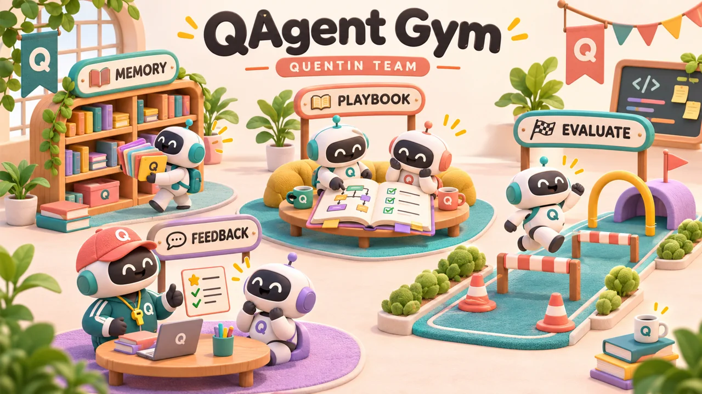

<section class="gym-hero" aria-labelledby="qagent-gym" markdown="1">

<div class="gym-hero__copy" markdown="1">

# QAgent Gym

Train agents on feedback. Test what they learn.

Run a QAgents agent on a practice task, turn useful feedback into a playbook, and check the result on held-out tasks. Start with a local demo that needs no API key.

<div class="gym-actions" markdown="1">

[Run the offline demo](#run-the-offline-demo)
[Explore the scenarios](#application-scenarios)

</div>

</div>

<div class="gym-hero__art" markdown="1">



</div>

</section>

<section class="gym-paths" aria-labelledby="choose-a-workflow" markdown="1">

## Choose a workflow

<div class="gym-paths__grid" markdown="1">

<div markdown="1">

### [Learn from feedback](docs/examples.md)

Turn a review into a reusable rule. Run the same held-out tasks against a frozen copy of the learned context.

</div>
<div markdown="1">

### [Rehearse a restart](docs/erasmus-example.md#rehearse-worker-restart-and-backup-restore)

Kill a KA220 proposal worker and recover the draft from its mailbox and journals. Compare the result with a backup restore.

</div>
<div markdown="1">

### [Compare recovery behavior](docs/recovery-benchmark.md)

Inspect where QAgents and LangGraph resume after a crash, with independent checks for missing or duplicate writes.

</div>

</div>

</section>

## How training and evaluation work


Gym uses an ACE-inspired generator, reflector, and curator to improve the
context an existing agent receives. It keeps the model weights fixed. The
scripted demo uses the real QAgents loop and measures the tasks included in
that demo. [Architecture diagrams](docs/diagrams/README.md)

## Run the offline demo

Requires Python 3.11+ and qagents 0.2.x or 0.3.x. The validated checkout is 0.2.0;
compatibility with an eventual 0.3 release must be checked before upgrading.
Install your local qagents checkout first if it is not published on your index:

```powershell
python -m venv .venv
.venv\Scripts\Activate.ps1
python -m pip install -e 'C:\path\to\qagents'
python -m pip install -e '.[dev]'
python -m qagent_gym demo --db .gym/demo.sqlite3 --export .gym/episodes.jsonl
```

A fresh namespace reports `training_reward: 0.0`, `evaluation_rewards: [1.0, 1.0]`
and `frozen_evaluation: true`. The training task teaches a metres-to-centimetres
rule. The database closes and reopens before two different tasks use that rule.
Reusing a database intentionally retains learning; use `--namespace another-run`
for a fresh experiment. Export refuses to replace an existing file.

```powershell
python -m qagent_gym export --db .gym/demo.sqlite3 --namespace metres-demo --output .gym/history.jsonl
python examples/offline_learning.py
python -m pytest -q
python -m ruff check src tests examples
python -m ruff format --check src tests examples
python -m hatchling build
```

## Run a configured model

Use an existing local or hosted OpenAI-compatible endpoint that supports tool calls:

```console
python -m examples.real_agents tools --base-url http://127.0.0.1:8000/v1 --model YOUR_MODEL_ID
```

The [real-agent guide](docs/real-agents.md) walks through typed tools, an explicit
approval followed by durable resume, and a supervisor delegating to a specialist.
It explains provider configuration and how to inspect the actual tool results.
The provider path was tested with mock HTTP responses; no live model call is
implied. Choose `--fixture` explicitly for an offline setup check.

## More runnable examples

These recipes use the real qagents loop with scripted models and local state.
They need no model credentials:

| Recipe | Run | What it checks |
| --- | --- | --- |
| Peer feedback | `python -m examples.peer_feedback` | A reviewer gives feedback that becomes a reusable writing rule. |
| Tool regression | `python -m examples.tool_regression` | Tool calls, results and units stay aligned across tasks. |
| Before/after evaluation | `python -m examples.before_after` | The same fixed test tasks run before and after learning with frozen memory. |
| Optional integrations | `python -m examples.integration_contracts` | Mem0 and Lightning boundaries run against fake clients. |
| Evaluation exports | `python -m examples.evaluation_exports --db .gym/evaluation-exports/gym.sqlite3` | Separate answer keys go to Inspect JSONL; only training feedback goes to GEPA reflection data. |

See [the example guide](docs/examples.md) for expected outputs and persistent
database options. These scripted demonstrations check behavior; their scores
are not evidence of improvement on real models.

## Application scenarios

- **[Erasmus+ KA220 proposal](docs/erasmus-example.md):** generate a complete
  fictional adult-education planning draft, review its sections and budget, persist
  a correction, and produce the corrected proposal with unresolved evidence gaps.
  Run `python -m examples.erasmus_proposal --output-dir .gym/erasmus-proposal`.
- **[Banking application](docs/banking-example.md):** use actual qagents tools for
  accounts, balances, history and transfers in a persistent fictional ledger.
  Run `python -m examples.banking_app --db .gym/banking.sqlite3 demo`.
  Ownership, paired postings, idempotency and concurrent-spend checks are tested.
- **[English and Greek voice](docs/voice-example.md):** connect local ASR to qagents
  and native speech synthesis, with interruption, deadlines and separate latency
  measurements. The guide includes optional speech dependencies and the full run
  command. Six native audio trials passed; median first-response-WAV times were
  483 ms in English and 555 ms in Greek on the tested machine.

These scenarios use deterministic qagents policies. The voice recognition and
synthesis checks use real local speech models/voices. The KA220 output is a
fictional draft requiring real evidence and call-specific review; the banking
sample uses only local TEST units. Voice measurements cover short synthetic
utterances and exclude recording/playback, network and live-LLM latency.

## Use your own qagents agents

`QAgentsGenerator` takes an existing text-output `Agent`. It calls public
`Agent.run`, bounds turns/time/tokens, starts a fresh session per task, checks
`result.status`, and captures observable messages and tool calls/results.
The caller owns model connections and should close them when done. Supplied
agents may contact their configured providers; only the scripted demo is offline.

```python
import asyncio

from qagents import Agent
from qagents.models.testing import ScriptedModel

from qagent_gym.gym import ExactMatchEvaluator, Gym
from qagent_gym.qagents_adapter import QAgentsGenerator, QAgentsReflector
from qagent_gym.records import Task
from qagent_gym.storage import SQLiteStore


async def main():
    solver = QAgentsGenerator(Agent(ScriptedModel(["wrong", "right"])))
    reviewer = QAgentsReflector(QAgentsGenerator(Agent(ScriptedModel([
        '[{"bullet_id":"verify","text":"Check the result before answering."}]'
    ]))))
    evaluator = ExactMatchEvaluator({"practice": "right", "heldout": "right"})
    with SQLiteStore("learning.sqlite3") as store:
        gym = Gym(solver, evaluator, reviewer, store)
        await gym.train(Task("practice", "Solve the practice task"), namespace="example")
        results = await gym.evaluate([
            Task("heldout", "Solve a different task", split="eval")
        ], namespace="example")
        print(results[0].reward.value)


asyncio.run(main())
```

The minimal `Generator`, `Evaluator`, `Reflector`, `Curator`, and `MemoryStore`
protocols are in `gym.py`. An evaluator can return objective feedback, a user's
correction, or a peer agent's review as a typed `Reward`. That feedback reaches
the reflector only after the attempt. A peer-review callback is a supported
extension point; no consensus or social-learning algorithm is implemented.

## Persistence and evaluation contract

- SQLite stores scoped memory, playbooks, change history and immutable episodes.
  Memory retrieval uses case-insensitive word overlap, not embeddings.
- Playbook deltas use stable IDs, provenance and helpful/harmful counters.
  Identical replay is a no-op; reusing an ID with another payload fails. Batches
  commit atomically. Distinct updates use last-writer-wins, so serialize training
  jobs sharing a namespace. Semantic deduplication is not implemented.
- `evaluate` freezes all input contexts before starting. It never reflects,
  curates or adds memory. Evaluation episodes are still logged. Answer keys live
  in the evaluator and are not sent to the solving agent.
- Learning uses the supplied feedback; it does not establish that a lesson is
  true. Keep held-out tasks separate and compare the same tasks before/after
  adaptation when measuring quality. Learned text is explicit model input.
- Exceptions propagate. An episode is saved before adaptation, but the entire
  model/memory/curation sequence is not a crash-resumable transaction. A failure
  may leave an episode without learning, or a playbook update without memory.
- Paused/blocked/limited runs expose no final answer and do not adapt. The adapter
  does not resume approvals. JSONL contains observable traces and feedback;
  it lacks the sampled token IDs and log probabilities needed for policy RL.
- The adapter rejects context larger than 20,000 characters by default instead
  of silently truncating it. Scope memories or deprecate irrelevant bullets.

## Optional integrations

[Six integration recipes](docs/integrations.md) connect Mem0, LangGraph, DSPy,
ElevenLabs, Twilio and OpenTelemetry through explicit, optional adapters.
They include frozen memory snapshots, isolated graph threads, bilingual voice
fixtures, signed webhooks and correlated agent/reward traces. SDK contract tests
use real libraries with local inference or transport substitutes.

Install only the extra you need, for example `pip install -e '.[langgraph]'`.
Importing the adapters does not construct clients or read service credentials.
No live ElevenLabs synthesis, Twilio phone call or Mem0 service was used in
validation. See [voice service boundaries](docs/integrations-voice-services.md).

[Agent Lightning and RL](docs/rl.md) documents the v1 gateway route, Linux/WSL
constraints, TRL/verl alternatives, and a pure reward-event bridge. No Lightning
controller or optimizer has been run.

[Inspect AI and GEPA exports](docs/optimization.md) support independent evaluation
and future context optimization without adding either framework to base dependencies.
The optional native-reader test passed with Inspect AI 0.3.289; no solver or
optimizer run is implied by that check.
The [current ecosystem survey](docs/ecosystem.md) ranks further integrations and
records upstream versions, contracts, licenses and the experiments still needed.

See [SPEC.md](SPEC.md) for contracts and acceptance criteria and
[sources and licenses](docs/sources.md) for upstream references.

## Guides and background jobs

[Background worker recipes](docs/background-jobs.md) exercise queued runs,
cancellation and recovery using the qagents runtime. Their limits are documented
separately from the Gym learning transaction.

The [recovery benchmark](docs/recovery-benchmark.md) compares QAgents and LangGraph
using an independent durable service ledger, matching fault boundaries and real
worker-process termination. It records correctness controls, raw observations
and separate startup, lease-wait and recovery timings.

Build a local copy with `python scripts/build_guides.py --output .work/guides`.
The [hosting guide](docs/guides-hosting.md) describes the private publication
workflow; public hosting is not configured.

The [private Quentin handbook](https://quentin-qagents-guides.innovationbee.chatgpt.site/)
provides a shared entrance to these guides and the qagents runtime reference.
Access is controlled by the hosting service.
