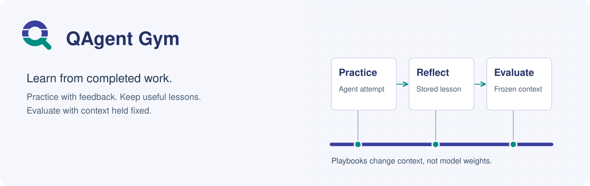
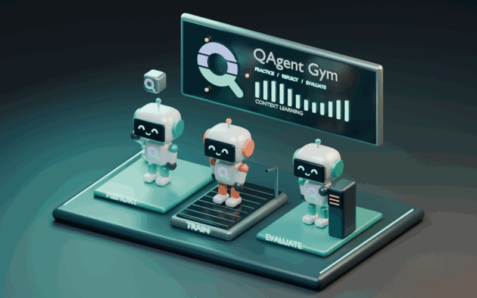

# QAgent Gym

Context learning and evaluation for QAgents, with persistent playbooks and memory.



<div class="gym-cinema gym-home-cinema">
<picture>
  <source media="(prefers-reduced-motion: reduce)" srcset="assets/quentin-gym-future.webp">
  <source type="image/webp" srcset="assets/quentin-gym-future-animated.webp">
  
</picture>
</div>

[Start here](docs/start-here.md) · [Examples](docs/examples.md) ·
[Memory](docs/memory.md) · [Reinforcement learning](docs/rl.md) ·
[Private handbook](https://quentin-qagents-guides.innovationbee.chatgpt.site/gym/) ·
[Still image](assets/quentin-gym-future.webp)

## Learning across tasks

QAgent Gym is a Python package for improving an agent's context across tasks.
It gives a QAgents agent practice tasks, records its attempts and turns feedback
into a reusable playbook. SQLite keeps the lessons and episode history between
runs. Evaluate on held-out tasks to check whether those lessons help.

QAgents runs the model, tools, permissions and execution journal. Gym adds an
ACE-inspired generator, evaluator, reflector and curator around that runtime.
Context learning keeps model weights fixed. The [RL guide](docs/rl.md) explains the
reward bridge and the additional rollout data an external model trainer needs.

| Repository | Responsibility |
| --- | --- |
| [QAgents](https://github.com/qagents-ai/qagents) | Run agents, tools, approvals, durable sessions and sub-agent teams. |
| **QAgent Gym** | Practice, retain feedback and compare results on held-out tasks. |
| [QAgents Examples](https://github.com/qagents-ai/qagents-examples) | Start from runnable applications with their own tools and result checks. |

When building with Codex or Claude Code, connect the
[QAgents documentation server](https://github.com/qagents-ai/qagents/blob/main/docs/coding-agents.md)
so the assistant can look up the installed runtime API. Use this repository's
[configured-agent guide](docs/real-agents.md) to connect that application to Gym.

## Run the offline demo

Requires Python 3.11+. Install QAgents from your checkout, then install Gym from
this repository. The validated QAgents version is 0.2.0. Gym declares support
for `qagents>=0.2,<0.4`.

```powershell
python -m venv .venv
.venv\Scripts\Activate.ps1
python -m pip install -e 'C:\path\to\qagents'
python -m pip install -e '.[dev]'
python -m qagent_gym demo --db .gym/demo.sqlite3 --export .gym/episodes.jsonl
```

The scripted agent first misses a metres-to-centimetres conversion. Gym stores a
lesson, closes and reopens the database, then evaluates two new questions. A fresh
namespace reports these values in its JSON output.

```json
{
  "training_reward": 0.0,
  "evaluation_outputs": ["700", "900"],
  "evaluation_rewards": [1.0, 1.0],
  "frozen_evaluation": true,
  "episodes": 3
}
```

Reusing the database retains its context. Add `--namespace another-run` for a fresh
experiment and choose a fresh export path. The scores describe this scripted demo.

## How training and evaluation work

[](assets/diagrams/gym-learning-flow.svg)

During practice, the generator runs with the current playbook and retrieved
memories. An evaluator scores the attempt. The reflector proposes a lesson from
that feedback, and the curator decides how to update the playbook. SQLite retains
the episode history and the source of each lesson.

Evaluation captures each task's context before the batch and uses private answer
keys to score the outputs. The playbook and memory stay frozen for that batch.

[Explore the architecture](docs/diagrams/README.md) or
[compare the same tasks before and after learning](docs/start-here.md#measure-a-change).

## Choose a workflow

| Task | Guide |
| --- | --- |
| Teach a reusable rule from feedback | [Offline learning and peer review](docs/examples.md) |
| Run your model with tools and approvals | [Configured agents](docs/real-agents.md) |
| Run multi-step environments and measure repeated outcomes | [Environment rollouts and Gymnasium](docs/environment-rollouts.md) |
| Retain memories for a project | [Scoped memory and Mem0](docs/memory.md) |
| Rehearse worker restart and backup restore | [KA220 mailbox pilot](docs/erasmus-example.md#rehearse-worker-restart-and-backup-restore) |
| Compare recovery with LangGraph | [Process-recovery benchmark](docs/recovery-benchmark.md) |
| Export a dataset or reward | [Inspect AI and GEPA](docs/optimization.md), [RL reward bridge](docs/rl.md) |

## Connect a QAgents agent

Wrap an existing text-output agent with `QAgentsGenerator`. Supply a reviewer
agent for reflection and an evaluator that can verify the task result.

```python
from pathlib import Path

from qagent_gym.gym import ExactMatchEvaluator, Gym
from qagent_gym.qagents_adapter import QAgentsGenerator, QAgentsReflector
from qagent_gym.records import Task
from qagent_gym.storage import SQLiteStore


async def learn_conversion(solver_agent, reviewer_agent):
    evaluator = ExactMatchEvaluator({"practice": "300", "heldout": "700"})
    Path(".gym").mkdir(exist_ok=True)
    with SQLiteStore(".gym/conversion.sqlite3") as store:
        gym = Gym(
            QAgentsGenerator(solver_agent),
            evaluator,
            QAgentsReflector(QAgentsGenerator(reviewer_agent)),
            store,
        )
        await gym.train(
            Task("practice", "Convert 3 metres to centimetres."),
            namespace="conversion-v1",
        )
        results = await gym.evaluate(
            [Task("heldout", "Convert 7 metres to centimetres.", split="eval")],
            namespace="conversion-v1",
        )
        return results[0].reward.value
```

The adapter starts a fresh agent session per task and bounds turns, time, tokens
and context size. Completed attempts can teach the playbook. Incomplete attempts
retain their status. The caller owns provider connections and closes them after use.
See the [execution and storage contracts](SPEC.md#core-contracts) for concurrency,
failure and recovery behavior.

## Run a configured model

Use an existing OpenAI-compatible endpoint that supports tool calls.

```console
python -m examples.real_agents tools --base-url http://127.0.0.1:8000/v1 --model YOUR_MODEL_ID
```

The [configured-agent guide](docs/real-agents.md) covers credentials, typed tools,
an approval followed by durable resume, and a supervisor delegating to a specialist.
It records which paths use fixtures and which contact your selected provider.

## Application scenarios

| Scenario | What you can run |
| --- | --- |
| [Erasmus+ KA220](docs/erasmus-example.md) | Generate and review a complete fictional proposal, retain a correction, and rehearse worker recovery. |
| [Banking sandbox](docs/banking-example.md) | Exercise account ownership, transfers, idempotency and concurrent-spend checks in a persistent TEST ledger. |
| [English and Greek voice](docs/voice-example.md) | Connect local recognition and synthesis to an agent with interruptions and latency measurements. |
| [Background workers](docs/background-jobs.md) | Queue, cancel and recover runs using the QAgents runtime. |

The proposal needs real partner evidence and call-specific review before use.
The banking example uses fictional TEST units. Each guide records its test setup
and the service integrations exercised.

## More runnable examples

The [environment learning example](https://github.com/qagents-ai/qagent-gym/blob/main/examples/environment_learning.py) turns a
failed review workflow into a reusable procedure. The
[native replay benchmark](docs/environment-rollouts.md#native-replay-benchmark)
runs the same seeded Gymnasium tasks through QAgents and LangGraph, with
QAgents reliability reports. See the [current ecosystem review](docs/ecosystem-extensions.md)
for checked libraries, versions and integration decisions.

Run these from the repository checkout after installation.

```console
python -m examples.peer_feedback
python -m examples.tool_regression
python -m examples.before_after
python -m examples.integration_contracts
python -m examples.evaluation_exports --db .gym/export-demo/gym.sqlite3
```

These examples use scripted policies and local state. They demonstrate feedback,
tool-result checks, frozen comparisons, injected service clients and dataset
exports. See [expected outputs and fresh namespace options](docs/examples.md).

## Optional integrations

Install the extra for the adapter you use, such as `pip install -e '.[mem0]'`.

| Integration | Available boundary | Guide |
| --- | --- | --- |
| Mem0 | Injected client, scoped retrieval and provenance | [Memory](docs/memory.md) |
| LangGraph / DSPy | Generator adapters and isolated evaluation contexts | [Framework adapters](docs/integrations-memory-frameworks.md) |
| ElevenLabs / Twilio | Speech service adapters and signed voice webhooks | [Voice services](docs/integrations-voice-services.md) |
| OpenTelemetry | Correlated agent, episode and reward traces | [Tracing](docs/integrations-tracing.md) |
| Inspect AI / GEPA | Evaluation datasets and reflection exports | [Optimization exports](docs/optimization.md) |
| Agent Lightning | Validated reward events through an injected transport | [Reinforcement learning](docs/rl.md) |

[Integration recipes](docs/integrations.md) describe the SDK contracts and
local substitutes used in validation. A full Agent Lightning rollout and
optimizer run remain future work.

## Documentation

The [private QAgents handbook](https://quentin-qagents-guides.innovationbee.chatgpt.site/)
contains the Gym guides and QAgents runtime reference. To build the guides locally:

```console
python -m pip install -e '.[docs]'
python scripts/build_guides.py --output .work/guides
```

See [private hosting](docs/guides-hosting.md), the
[recovery benchmark](docs/recovery-benchmark.md), and
[sources and licenses](docs/sources.md) for operational details and upstream references.

## Development

```console
python -m pytest -q
python -m ruff check src tests examples
python -m ruff format --check src tests examples
python -m hatchling build
```

The animated gym is a rendered illustration. Its editable Blender source and
animation reproduction commands are in the [artwork notes](assets/README.md).
