# Architecture diagrams

These technical diagrams are generated from the adjacent Mermaid `.mmd` sources,
not painted into an image. The SVGs retain searchable text and scale without
blurring. They use one shared theme, accessible titles/descriptions and a consistent
color palette. The Quentin robot artwork remains a separate illustration.

## Execution and adaptation



QAgents owns the agent loop, permission checks and execution journal. The host
owns configuration and authorization. Gym adds a separate store and adaptation
workflow; its evaluator keeps answer keys outside the agent's input.

## Learning and evaluation



Training feedback can produce lessons and memories with provenance. Evaluation
captures its contexts before running the batch and records results without
reflecting or changing learned context. Provider state and external tools remain
the host's responsibility. This diagram depicts context updates, not weight training.

## Effect lifecycle and recovery — specification draft


**Draft design, not evidence of a released implementation.** The Effects writer
must confirm the final public API and crash tests before this diagram is presented
as implemented behavior. The important decision is whether there is a recorded
receipt, operation-bound evidence permitting a resend, or an unresolved outcome
that must remain held. Do not treat this diagram as permission to blindly repeat
an external write.

## External agents: control and tool protocols


The control protocol drives the external agent's session and permission requests.
MCP supplies tools to that agent. They are separate interfaces with opposite
client/server roles. The illustrated MCP server is bound to a run through a
supplied `ctx`; a standalone server without that context does not journal calls.
The source is also supplied to the QAgents documentation
writer to replace its old ASCII diagram.

## Re-render from source

Rendering was validated with Mermaid CLI **12.2.0**, Node.js and an installed
Chrome browser. The toolchain lives under `.work`; no global package or Python
environment is changed. The SVGs in `assets/diagrams/` are ready to embed in static
documentation without a runtime Mermaid dependency.

PowerShell setup and rendering:

```powershell
$env:PUPPETEER_SKIP_DOWNLOAD = 'true'
npm install --prefix .work/diagram-tools --save-exact @mermaid-js/mermaid-cli@12.2.0
python scripts/render_diagrams.py --browser 'C:\Program Files\Google\Chrome\Application\chrome.exe' --previews .work/diagram-previews
```

Supply your actual Chrome/Chromium path. Rendering is headless; no user browser
tab is controlled. The command updates the four generated SVGs and optionally
creates PNGs for visual review. The browser and npm packages are not needed to
read the resulting guides. The renderer keeps intermediate configuration in
`.work/diagram-render-*`; it does not delete source or output directories.

The [official Mermaid CLI documentation](https://github.com/mermaid-js/mermaid-cli)
describes its source-to-SVG/PNG workflow. Rendered PNG previews were visually
checked for clipping, label readability and arrow direction; they are review
artifacts, while the versioned publication assets are SVGs.
