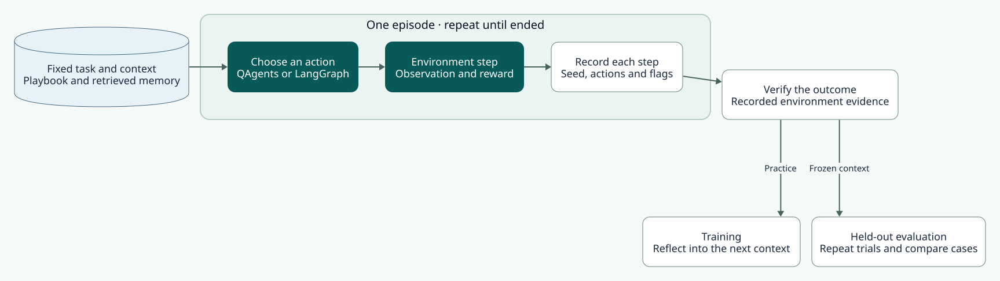
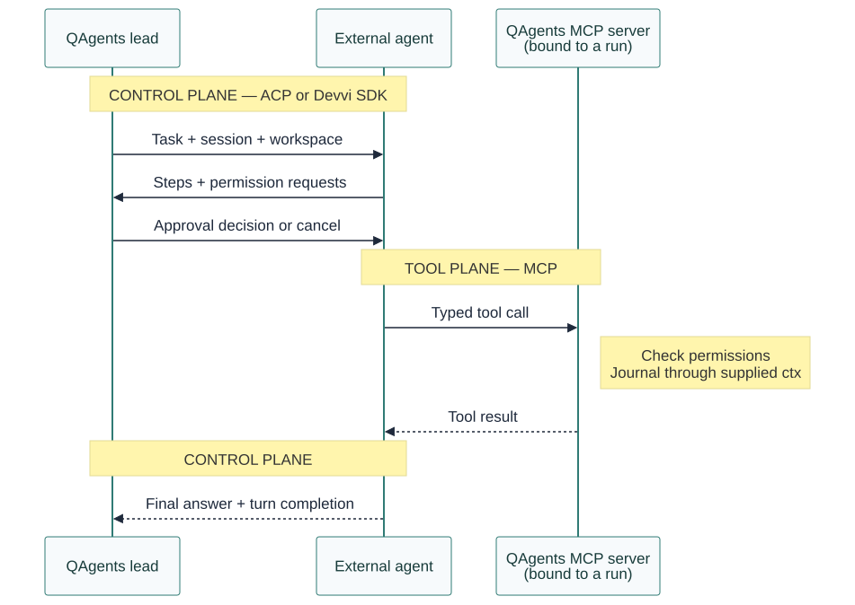

# Architecture diagrams

Open any diagram at full size. The editable sources live beside this page.
D2 with ELK lays out the architecture, learning and rollout flows. Mermaid
renders the Effects lifecycle and external-agent protocol diagrams. The guides
serve the generated SVG files directly.

## Execution and adaptation

[](../../assets/diagrams/architecture.svg)

QAgents owns the agent loop, permission checks and execution journal. The host
owns configuration and authorization. Gym adds a separate store and adaptation
workflow; its evaluator keeps answer keys outside the agent's input.

## Learning and evaluation

[](../../assets/diagrams/gym-learning-flow.svg)

Training feedback can produce lessons and memories with provenance. Evaluation
captures its contexts before running the batch and records results without
reflecting or changing learned context. Provider state and external tools remain
the host's responsibility.

## Reinforcement-learning rollout

For the implemented reset/action/step interaction and context-learning path,
see [multi-step environment rollouts](../environment-rollouts.md).

[](../../assets/diagrams/environment-rollouts.svg)

[](../../assets/diagrams/rl-rollout.svg)

The solid path is available in Gym. The dashed paths describe a proposed
Agent Lightning setup. Follow the [RL guide](../rl.md) to reproduce the local
reward preview and see what a trainer needs.

## Effect lifecycle and recovery — specification draft

[](../../assets/diagrams/effect-recovery-draft.svg)

**Draft design, not evidence of a released implementation.** The Effects writer
must confirm the final public API and crash tests before this diagram is presented
as implemented behavior. The important decision is whether there is a recorded
receipt, operation-bound evidence permitting a resend, or an unresolved outcome
that must remain held. Do not treat this diagram as permission to blindly repeat
an external write.

## External agents: control and tool protocols

[](../../assets/diagrams/external-agent-planes.svg)

The control protocol drives the external agent's session and permission requests.
MCP supplies tools to that agent. They are separate interfaces with opposite
client/server roles. The illustrated MCP server is bound to a run through a
supplied `ctx`; a standalone server without that context does not journal calls.
The source is also supplied to the QAgents documentation
writer to replace its old ASCII diagram.

## Re-render from source

For the `.d2` diagrams, extract the binary for your platform from
[D2 v0.9.0](https://github.com/d2lang/d2/releases/tag/v0.9.0)
and pass its path to the renderer. The palette is in
[`theme/gym.d2`](theme/gym.d2).

```powershell
python scripts/render_diagrams.py --d2 'C:\path\to\d2.exe'
```

For the `.mmd` diagrams, install Mermaid CLI **12.2.0** under `.work`
and pass the path to an installed Chrome or Chromium binary.

```powershell
$env:PUPPETEER_SKIP_DOWNLOAD = 'true'
npm install --prefix .work/diagram-tools --save-exact @mermaid-js/mermaid-cli@12.2.0
python scripts/render_diagrams.py --browser 'C:\Program Files\Google\Chrome\Application\chrome.exe' --previews .work/diagram-previews
```

The renderer updates the SVGs for the selected tool. You can pass both
`--d2` and `--browser` to update all five. `--previews` produces PNG previews
of the Mermaid diagrams.

The [official Mermaid CLI documentation](https://github.com/mermaid-js/mermaid-cli)
describes its source-to-SVG/PNG workflow. The [D2 styling guide](https://d2lang.com/tour/style/)
documents the node and connector styles shared by the D2 sources.
