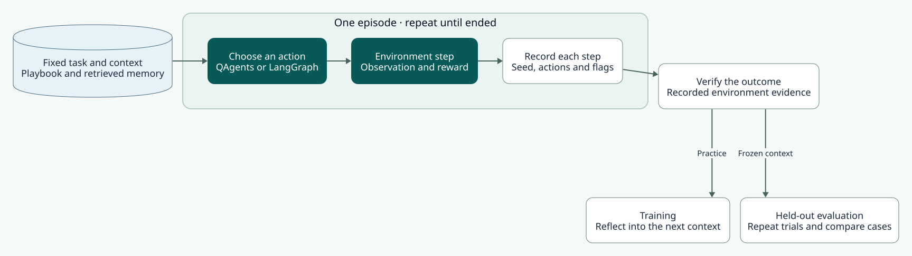

# Multi-step environment rollouts

Run a policy against an environment that changes after each action. Gym records
the observation, policy decision, environment response and why the episode ended.

[](../assets/diagrams/environment-rollouts.svg)

## Run the examples

Install QAgents from its current main checkout first, then install Gym. The
benchmark uses the new QAgents `TrialTarget` and reliability APIs. The custom
learning example needs only the base packages.

```console
python -m pip install -e ../qagents
python -m pip install -e '.[gymnasium,langgraph,dev,docs]'
python -m examples.environment_learning
python -m examples.environment_benchmark --output-dir .gym/environment-benchmark
```

Choose a new output directory for each benchmark run. Existing trajectory files
are preserved.

The review-workflow example starts with an agent that submits a draft before
checking it. A failed practice episode teaches a reusable review/revise/submit
procedure. Two held-out briefs then complete that sequence while playbook and
memory stay frozen. This is a local checklist fixture with scripted decisions,
separate from the [complete KA220 proposal example](erasmus-example.md).

## Use a real Gymnasium environment

```python
import asyncio

import gymnasium
from qagents import Agent, Limits
from qagents.models.testing import ScriptedModel

from qagent_gym.integrations import GymnasiumEnvironment
from qagent_gym.qagents_adapter import QAgentsGenerator
from qagent_gym.records import Context, Task
from qagent_gym.rollouts import GeneratorPolicy, run_episode


async def frozen_lake():
    task = Task(
        "lake",
        "Map: SFFF/FHFH/FFFH/HFFG. The observation is a row-major cell index. "
        "Actions: 0=left, 1=down, 2=right, 3=up. Reach G. Return a JSON integer.",
        split="eval",
    )
    context = Context("lake-evaluation")
    generator = QAgentsGenerator(
        Agent(ScriptedModel(["1", "1", "2", "1", "2", "2"])),
        limits=Limits(
            max_turns=2, max_total_tokens=2048, max_cost_usd=0.05, timeout_s=5
        ),
    )
    environment = GymnasiumEnvironment(
        gymnasium.make("FrozenLake-v1", is_slippery=False)
    )
    rollout = await run_episode(
        environment, GeneratorPolicy(generator, task, context),
        task, context, seed=42, max_steps=12, timeout_s=30,
    )
    print(rollout.total_reward, rollout.terminated, rollout.truncated)
    return rollout


if __name__ == "__main__":
    asyncio.run(frozen_lake())
```

The result is reward `1.0`, termination true and truncation false. Replace the
scripted agent with an [existing configured agent](real-agents.md) to select
actions through your provider. Its output must be the environment action: a JSON
integer for Discrete spaces, or the space's JSON representation for other spaces.

`GeneratorPolicy` also accepts the existing `LangGraphGenerator` or another Gym
generator. Each decision receives the fixed task/context and visible
observation/action history. Diagnostic environment info is retained in the audit
record and is excluded from action-selection prompts.

## Connect rollouts to context learning

Supply fresh environment and policy factories to `RolloutGenerator`, then use
`EnvironmentReturnEvaluator` with the ordinary Gym training/evaluation APIs.
The complete [learning example](https://github.com/mpvasilis/qagent-gym/blob/main/examples/environment_learning.py) shows the
reflector, SQLite store and frozen-state assertions.

The evaluator sums rewards from the runner's recorded environment responses.
A model's answer cannot set those values. Use this evaluator with the trusted
rollout generator; it does not authenticate arbitrary uploaded trajectories.
A terminal failure is a completed interaction with its actual reward. Truncated
or incomplete interactions receive zero for Gym adaptation, with original
transition rewards preserved in the audit record.

The generation output is the public final observation. The full trajectory
lives in the `environment_rollout` tool-result evidence. This keeps diagnostic
info out of the memory text automatically retained by Gym.

## End states and resource ownership

| End state | Meaning | Gym generation |
| --- | --- | --- |
| `terminated` | The environment reached an MDP terminal state, including failure states. | Completed; environment reward decides quality. |
| `truncated` | The environment's external cutoff ended the interaction. | Limit reached. |
| `max_steps` | The runner exhausted its own step budget. | Limit reached. |
| `policy_stopped` | The policy paused, was blocked, cancelled or reached a limit. | The policy's incomplete status is retained. |

Gymnasium may set both terminal flags on the same step. Both flags remain in the
record. `rollout.terminated` reflects the terminal flag; `rollout.truncated`
also accounts for the controller's step limit. `stop_reason` identifies which
path ended execution.

Each call owns one environment and policy. The runner closes the environment on
success, invalid configuration, provider/environment failure, timeout and
cancellation. Exceptions propagate and do not become successful trajectories.
The Gymnasium adapter serializes native calls and cleanup on one worker thread.
Native calls must return before cleanup finishes; the deadline is cooperative.
Use an executor with process isolation for a native environment that can hang.

Generator execution limits apply per decision. The rollout's finite step budget
and deadline bound the sequence. Construct lightweight factories and perform
asynchronous setup in `reset` so it is covered by the rollout deadline.

## Inspect and export a trajectory

`rollout.to_json()` writes schema version 1 with a format marker. `Rollout.from_json`
validates the context, generation statuses, observation chain, step budget, end
flags and finite rewards. It rejects unknown/missing fields, duplicate JSON keys,
non-finite numbers and transitions after an ended environment.

`rollout.save(path)` creates a new UTF-8 JSON file and refuses replacement.
Records contain observable messages, actions, observations, rewards and diagnostic
info. Provider sampling token IDs and log probabilities require a separate capture
path before using an external model trainer.

## Native replay benchmark

The checked run uses Gymnasium 1.4.0, LangGraph 1.2.23 and LangChain Core 1.8.3.
It runs deterministic and slippery FrozenLake with seeds 0 through 19 through both
frameworks: 80 rollouts in total. Each framework produced 38 environment
terminations and two time-limit truncations.

For each task and seed, the recorded observations, actions, rewards, flags and
stop reasons agree across frameworks. The paired outcome difference is zero.
Policies are scripted; this checks native adapter/runner behavior. It does not
rank models, measure provider latency or collect token/cost usage.

The reproducible command is above. The checked
[summary](../assets/benchmarks/environment-contracts/summary.json) and
[provenance](../assets/benchmarks/environment-contracts/provenance.json) record
the inputs, versions and source hashes. Every rollout JSON is retained beside
the summary. See the [ecosystem review](ecosystem-extensions.md) for upstream
sources and integration decisions.
