# Run real agents with your configured model

QAgents can run a tool-using assistant, pause a proposed action for approval, and
let a supervisor delegate to another agent. The example below uses those public
APIs with `OpenAIChatModel`. Its normal path sends requests to the model endpoint
you configure. It does not silently substitute a scripted model.



## Choose the endpoint explicitly

Run from this repository checkout with QAgents and QAgent Gym installed. A local
OpenAI-compatible server must already be running, support Chat Completions tool
calls, and expose the model ID you supply:

```console
python -m examples.real_agents tools --base-url http://127.0.0.1:8000/v1 --model YOUR_MODEL_ID --db .gym/real-tools.sqlite3
```

For an explicitly selected hosted or private HTTPS endpoint:

```console
python -m examples.real_agents tools --base-url https://your-provider.example/v1 --model YOUR_MODEL_ID --db .gym/real-tools.sqlite3
```

Configure `QAGENTS_API_KEY` in the process environment through your normal secret
handling. The key is read only for the configured-provider path; do not put it in
the endpoint URL, prompt, command-line argument, or documentation. A local endpoint
that needs no key can leave it unset. `QAGENTS_BASE_URL` and `QAGENTS_MODEL` are
optional alternatives to the corresponding CLI flags. HTTP is accepted only on
loopback; remote endpoints require HTTPS.

There is no default endpoint, model, or implicit paid call. Missing configuration
fails before opening the session database. Running a configured remote provider
can send your prompt and tool results to it and incur its normal charges.

The example bounds turns, time, tool calls, nesting and reported tokens. Token
accounting depends on provider usage reports; it is not a provider-side spending
cap. For a compatible server that rejects `stream_options`, use
`--no-stream-usage`; token usage then becomes unavailable. Request retries are
disabled in this example. The host closes the HTTP client after the run.

## Use a typed tool for a concrete answer

The `tools` scenario asks for a quote for two desk lamps. The model chooses to call
`quote_catalog(product, quantity)`. The tool validates a known product and an
integer quantity from 1 to 20, then computes the price from a local fictional
catalog. The price is **5,000 TEST minor units**; no order is placed.

The agent's construction uses the ordinary QAgents API:

```python
from qagents import Agent, Limits, tool

@tool(read_only=True)
def catalog_price(product: str) -> int:
    """Return the fictional unit price in TEST minor units."""
    return {"desk-lamp": 2500, "notebook": 500}[product]

def catalog_agent(configured_model):
    return Agent(
        configured_model,
        instructions="Use catalog_price; do not invent prices or place orders.",
        tools=[catalog_price],
        limits=Limits(max_turns=6, timeout_s=60, max_tool_calls=4),
    )
```

Inspect `status` before consuming the result. The CLI reports the actual local
tool executions as well as the model's answer. A real model might answer without
calling a tool or fail to use the schema correctly; a `completed` status alone
does not prove that its answer is correct. Evaluate the model you intend to use.

## Pause, review the exact call, then resume

The `approval` scenario exposes a local `save_note` tool marked
`requires_approval=True`. It records notes in an application SQLite database;
it does not send messages, purchase anything, or modify an external service.

```console
python -m examples.real_agents approval --base-url http://127.0.0.1:8000/v1 --model YOUR_MODEL_ID --db .gym/review.sqlite3
```

When the model proposes a note, the result is `paused`. The CLI prints its
`session_id`, pending `tool_call_id`, tool name and proposed arguments. No note
has been stored. Read that exact proposed content before deciding:

```console
python -m examples.real_agents resume --base-url http://127.0.0.1:8000/v1 --model YOUR_MODEL_ID --db .gym/review.sqlite3 --session SESSION_ID_FROM_OUTPUT --call-id TOOL_CALL_ID_FROM_OUTPUT --decision approve
```

Use `--decision deny` to refuse it. Resuming requires the original database and
an actual pending call ID. The resume command reconstructs the agent and opens
the journal in a fresh process; it does not reissue the original user prompt.
Only the host-supplied decision authorizes the pending call. The model cannot
approve itself.

The notes table deduplicates `ctx.operation_id` and rejects a conflicting payload
for that ID. That is the local application's idempotency mechanism. It is not a
claim about payment or messaging services, nor an example of the upcoming Effects
API. The CLI is an operator demonstration: an application exposing approvals to
other users must authenticate its reviewers and check their session ownership.

## Let a supervisor delegate to a specialist

```console
python -m examples.real_agents supervisor --base-url http://127.0.0.1:8000/v1 --model YOUR_MODEL_ID --db .gym/team.sqlite3
```

The supervisor receives a `catalog_specialist` tool created with
`specialist.as_tool(read_only=True)`. The specialist starts its own conversation,
uses the catalog tool and returns its final answer. The supervisor then summarizes
that answer. The child receives the delegated task, not the supervisor's full
conversation, and shares the parent's remaining budgets.

The specialist has only read-only capabilities. A child that pauses is not a
mechanism for pausing its supervisor for approval; keep an approval-sensitive
action on the host-controlled path, as in the previous scenario.

The model endpoint is caller-owned and can be shared across these agents. The
example creates separate agent objects and instructions; it does not claim that
two calls to the same model are independent expert judgments.

## Reproduce the control flow without a provider

An explicit fixture mode is available for setup checks and tests:

```console
python -m examples.real_agents tools --fixture --db .gym/fixture-tools.sqlite3
python -m examples.real_agents approval --fixture --db .gym/fixture-approval.sqlite3
python -m examples.real_agents supervisor --fixture --db .gym/fixture-team.sqlite3
```

Resume a fixture approval using `resume --fixture` with its database, session,
call ID and an explicit decision. Fixture output identifies itself as
`explicit offline fixture`. It executes the real QAgents loop and real local
tools with a scripted model; it does not measure reasoning quality. Fixture mode
rejects simultaneous provider configuration so the execution path stays clear.

The tests additionally instantiate **the actual `OpenAIChatModel`** with
`httpx.MockTransport` and Chat Completions streaming responses. Those tests cover
tool serialization, supervisor delegation, approval before writes, database
reopen, explicit resume, and shared HTTP-client ownership. No live provider or
local inference server was called during this validation.

```console
python -m pytest tests/test_real_agents.py -q -p no:asyncio
python -m qagents.docs_mcp check examples/real_agents.py
```

Validated against the installed QAgents API: 15 targeted tests passed. For
context learning around a configured agent, pass it to `QAgentsGenerator`; keep
the evaluator's answer keys separate and freeze heldout context as described in
[the learning flow](diagrams/README.md#learning-and-evaluation).
