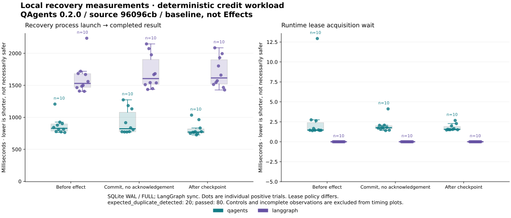
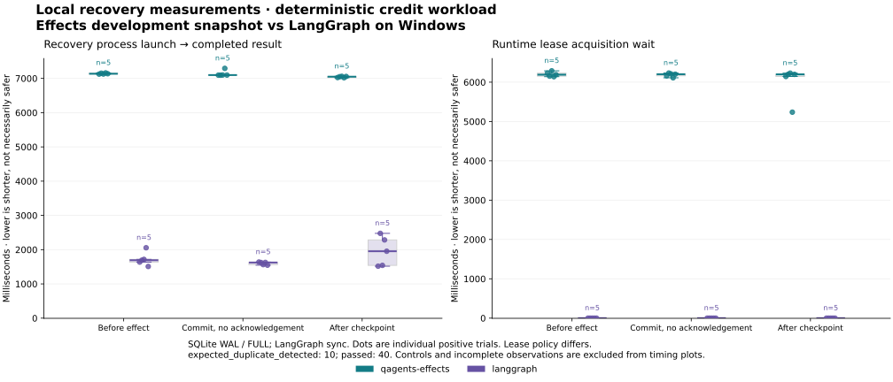

# QAgents and LangGraph: matched process-recovery experiment

Research and execution date: **2026-11-13**. This experiment uses actual child-process termination, a deterministic credit workflow and an independent loopback effect service. It measures worker recovery on one machine. It does not measure model quality or simulate a host power failure.

The baseline uses **QAgents 0.2.0, source 96096cb**, copied before Effects development. The November 14 experiment below exercises a separate Effects development snapshot.

## The common workload

Each trial plans one operation, credits **10 TEST units**, and returns the service's receipt. The business key is `credit-intent-1`; every trial has separate databases, so the same key identifies the same intent without sharing state between trials.

| Boundary | QAgents baseline | LangGraph |
| --- | --- | --- |
| Planning | Actual `Agent` with deterministic `FunctionModel` issues one typed tool call | Deterministic `plan` node records the same business key |
| Side effect | Tool declared `idempotent=True` sends the HTTP credit request | `credit` node sends the same HTTP credit request |
| Persistence | Public `AgentRuntime` and `SQLiteStore`; journaled tool start/result | Native `StateGraph` and `SqliteSaver`; invocation uses `durability="sync"` |
| Finalization | Next model request receives the persisted tool result | Next node receives the persisted receipt |
| Recovery | Fresh process calls `AgentRuntime.recover()` until the lease is available | Fresh process calls `graph.invoke(None, same_thread_config)` |

Both framework stores and the independent service ledger use **SQLite WAL / synchronous=FULL**. QAgents' setting is implemented by its SQLite store; the LangGraph connection is configured explicitly. This matches the durability setting, not the number or shape of database writes. QAgents also enforces a worker lease; the single-worker LangGraph harness does not implement a competing-worker lease. The figures therefore describe two configurations, not a framework speed ranking.

The controller owns the loopback HTTP service and remains alive while the worker dies. The service commits an intent, credit and request record in one SQLite transaction. With deduplication enabled, retrying the same key and amount returns the existing receipt. Reusing the key with a different amount fails. With deduplication disabled, another request applies another credit: this deliberately violates the tool's declared idempotent-service contract for the negative control.

LangGraph's [checkpoint documentation](https://docs.langchain.com/oss/python/langgraph/checkpointers) describes step boundaries, continuation and durability modes. Its [fault-tolerance documentation](https://docs.langchain.com/oss/python/langgraph/fault-tolerance) also explains why external effects require stable idempotency keys. The [native saver reference](https://reference.langchain.com/python/langgraph/checkpoints) identifies SQLite as a local saver; this is not a distributed-production comparison.

## Faults and required evidence

| Case | Barrier and independently inspected evidence | Expected service requests / credits |
| --- | --- | --- |
| No fault | Worker returns a completed receipt | 1 / 1 |
| Before effect | Worker enters the effect boundary; service ledger is empty when it is killed | 1 / 1 after recovery |
| Commit before acknowledgement | Service commits the credit but withholds the HTTP response; framework has no recorded result | 2 / 1 with deduplication |
| After checkpoint | Worker reaches finalization; a fresh process inspects the persisted receipt before resuming | 1 / 1; no repeated effect request |
| Negative control | Commit-before-ack fault with service deduplication deliberately disabled | 2 / 2; duplicate must be detected |

The controller verifies that the PID reported by executing Python is the exact PID owned by `Popen`. It then kills that child and requires a nonzero exit, the requested barrier, no completed first-worker result, and the expected ledger/checkpoint state. A correct final answer alone is insufficient. Missing barriers, malformed evidence, PID mismatch and recovery timeouts are **inconclusive**, not passed. Complete observations that contradict the expected outcome **fail**. Negative controls are reported separately as `expected_duplicate_detected`.

An early Windows run exposed a virtual-environment launcher PID that differed from the actual worker PID. Its artifacts are retained as superseded and its timings are not accepted. The final launcher bypasses that redirector, uses the actual base interpreter with isolated imports and explicit benchmark-environment dependencies, and checks identity before any fault kill. A regression test verifies the executing PID and real termination.

## Reproduce the experiment

Use a frozen QAgents source checkout and an isolated environment; do not change that source while the matrix runs. From the Gym repository:

```powershell
python -m venv .work/recovery-venv
.work/recovery-venv/Scripts/python.exe -m pip install -r benchmarks/recovery/requirements.txt
.work/recovery-venv/Scripts/python.exe -m benchmarks.recovery.run `
  --qagents-src C:/path/to/frozen-qagents/src `
  --output-dir .work/my-recovery-results `
  --repeats 10 --include-negative-control `
  --label 'QAgents version and source revision'
.work/recovery-venv/Scripts/python.exe -m benchmarks.recovery.plot .work/my-recovery-results
```

On Unix-like systems, use the environment's `bin/python` and shell-appropriate line continuation. The controller and worker logic support both Windows process termination and POSIX process kill; the recorded execution here is Windows only. The output directory must be new. Existing artifacts are never overwritten.

The benchmark-local requirements pin LangGraph **1.2.21**, checkpoint **4.3.1**, SQLite saver **3.1.3**, LangChain Core **1.8.0**, Pydantic **2.14.3**, HTTPX **0.28.1** and Matplotlib **3.11.2**. `metadata.json` records all installed distribution versions, Python, OS, CPU, SQLite, the source hash and configuration. The source hash is checked again after execution.

To execute the native regression matrix as well as the controller tests:

```powershell
$env:RUN_RECOVERY_BENCHMARK='1'
$env:QAGENT_RECOVERY_SOURCE='C:/path/to/frozen-qagents/src'
.work/recovery-venv/Scripts/python.exe -m pytest tests/test_recovery_benchmark.py -q
```

The ordinary test suite skips the ten explicitly opt-in native crash trials. Controller tests still check malformed artifacts, the key/payload conflict boundary, missing barriers, timeouts, actual process identity, duplicate detection and preservation of existing output. Tests use no paid model or remote service.

## Reading the artifacts and timings

Every trial retains both SQLite files, initial/recovery configuration, ready/result/barrier markers, events, stdout/stderr, persisted state inspection and `observation.json`. `raw.json` combines observations; `summary.json` groups outcomes and timing distributions. Matplotlib reads those raw observations to generate SVG and PNG charts; it excludes failed/inconclusive observations and negative controls from positive timing distributions, and discloses outcome counts.

The handbook includes the [raw observations](../assets/benchmarks/recovery-baseline/raw.json), [grouped summary](../assets/benchmarks/recovery-baseline/summary.json), [machine/package/configuration metadata](../assets/benchmarks/recovery-baseline/metadata.json) and [source-integrity check](../assets/benchmarks/recovery-baseline/source_integrity.json). The source scripts and pinned requirements live under `benchmarks/recovery/` in the Gym checkout; full per-trial databases and logs stay in the local run directory.

- **Launch → ready:** cold subprocess startup, imports and adapter setup. No artificial warm-import advantage is assigned to either framework.
- **Recovery launch → result:** fresh process startup, storage opening, recovery and completion. This includes any QAgents lease wait.
- **Lease acquisition wait:** time spent attempting to acquire recoverable QAgents work, shown separately. The configured lease TTL is **750 ms**, heartbeat **250 ms** and polling interval **10 ms**. LangGraph has no equivalent lease in this harness and reports zero.
- **Kill → result:** adds controller termination, ledger inspection and recovery-process launch overhead. It is not a live service's customer-facing response time.
- **Distribution:** count, minimum, median, nearest-rank p95 and maximum. Ten samples per cell are descriptive; their p95 is the sample maximum, not a precise tail estimate.

Framework order alternates by repeat. The workstation is shared and background load is not controlled. Cold caches, antivirus, scheduler activity and filesystem behavior can affect the numbers. There are no LLM calls, Internet provider latency, concurrent worker contention, queue-load test, hardware power loss, database failure or production traffic in this experiment.

Both implementations also perform durable diagnostic event writes at the same application boundaries. Those observations add overhead; these are instrumented recovery timings, not a minimally instrumented throughput test.

## Recorded validation

The revised controller/native test matrix passed **58 tests**, including the actual-PID regression and all ten native fault/control cases. The final repeated baseline completed **100 trials**: **80 positive cases passed**, **20 negative controls detected duplicate credits**, and **zero trials failed or were inconclusive**. These include 20 no-fault cases and 80 verified worker terminations. Every framework/fault/control cell has ten observations. QAgents' source hash remained unchanged throughout the run.



Recovery-process launch to completed result, including cold imports and storage reopening:

| Fault | QAgents median / p95 | LangGraph median / p95 |
| --- | --- | --- |
| Before effect | 827.6 / 1206.3 ms | 1529.3 / 2235.6 ms |
| Commit before acknowledgement | 821.8 / 1273.0 ms | 1604.7 / 2146.3 ms |
| After checkpoint | 770.5 / 1034.7 ms | 1615.1 / 2085.6 ms |

QAgents' median measured lease-acquisition loop was approximately **1.5–1.8 ms**. Most or all of the configured lease lifetime had already elapsed during cold process startup; the small acquisition time does not mean the lease policy was absent. The configurations have different recovery coordination and import paths, so the table is a local observation rather than a speed ranking.

Machine: Windows 11 build 26200, AMD64 Family 25 Model 80, 16 logical CPUs, Python **3.13.18**, SQLite **3.53.1**. Full environment details and all individual timings are linked above. Compact artifacts are retained under `benchmarks/recovery/results/baseline-96096cb/`; complete per-trial evidence is retained locally under `.work/recovery-baseline-96096cb-verified/`. The superseded launcher run remains under `.work/recovery-baseline-96096cb-results/` with `STOPPED.json` and is excluded from these measurements.

## Effects development snapshot, November 14

The Effects profile uses a typed `@effect`, `ctx.perform()`, a fenced SQLite journal and
`Agent.resume()` in a fresh process. The loopback destination receives the attempt's actual
idempotency key and records it alongside the business key. The controller checks the
persisted intent before recovery and verifies that the destination saw the same attempt
key after recovery. LangGraph uses the same deterministic credit workload and its native
synchronous SQLite checkpoint.

**40 positive trials passed and all 10 negative controls detected duplicate credits.**
The controller verified 40 worker terminations. The QAgents source hash remained stable.
The Effects profile uses a 6.1-second lease and a 2-second send timeout.

| Fault | Effects median kill → result | LangGraph median kill → result |
| --- | ---: | ---: |
| Before effect | 7.15 s | 1.71 s |
| Commit before acknowledgement | 7.11 s | 1.64 s |
| After checkpoint | 7.06 s | 1.97 s |

About 6.2 seconds of the Effects measurements were spent waiting for lease expiry and takeover
grace. The LangGraph scenario has one recovering worker and uses no corresponding lease. Each
cell contains five observations on one Windows machine.



[Raw trials](../assets/benchmarks/recovery-effects-preview/raw.json) ·
[Grouped summary](../assets/benchmarks/recovery-effects-preview/summary.json) ·
[Source hash and environment](../assets/benchmarks/recovery-effects-preview/metadata.json) ·
[Source integrity](../assets/benchmarks/recovery-effects-preview/source_integrity.json)

```powershell
.work/recovery-venv/Scripts/python.exe -m benchmarks.recovery.run `
  --qagents-src C:/path/to/frozen-effects/src `
  --output-dir .work/my-effects-recovery-results `
  --frameworks qagents-effects langgraph --lease-ttl 6.1 --repeats 5 `
  --include-negative-control --label 'Effects development snapshot vs LangGraph'
```

This experiment covers worker recovery at the three stated boundaries. Release validation
also requires the crash harness coverage, provider assumptions and cross-platform tests.
