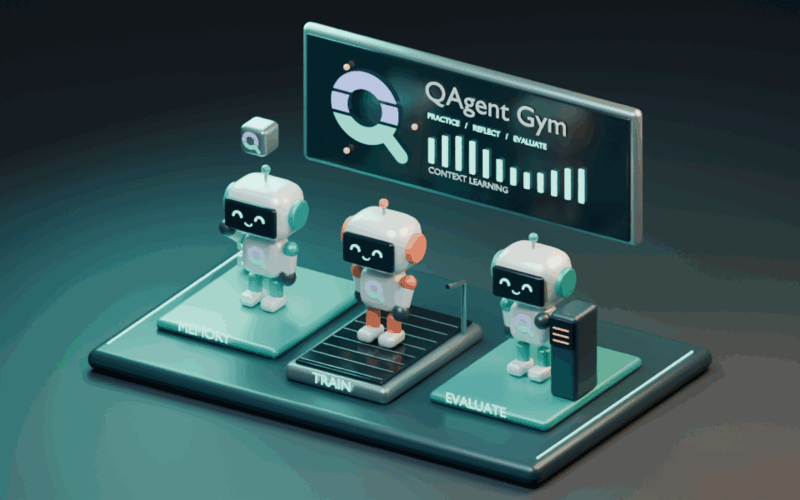
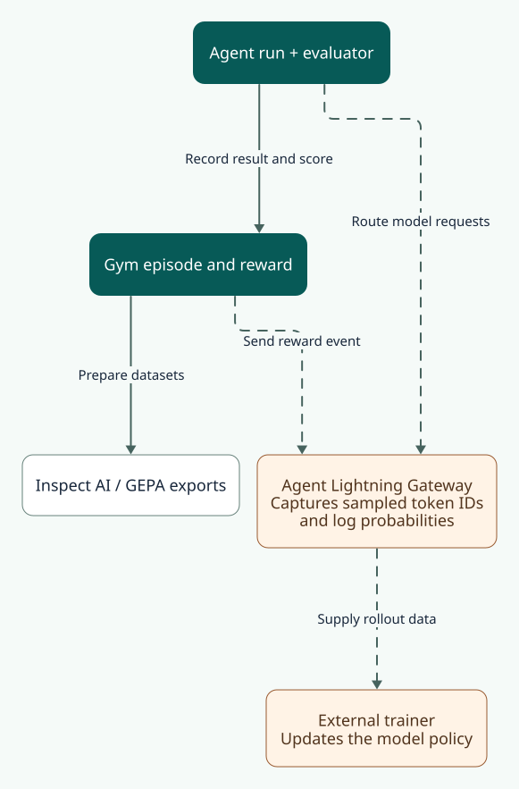

<section class="gym-guide-lead" aria-labelledby="reinforcement-learning" markdown="1">

# Reinforcement learning

Run and score an agent in Gym. Use the results to improve its playbook, build a
benchmark, or prepare a reward for an external trainer.

<div class="gym-actions" markdown="1">

[Run the offline example](#run-the-offline-example)
[See what a trainer needs](#what-a-trainer-needs)

</div>

<div class="gym-cinema">
<picture>
  <source media="(prefers-reduced-motion: reduce)" srcset="../assets/quentin-gym-future.webp">
  <source type="image/webp" srcset="../assets/quentin-gym-future-animated.webp">
  
</picture>
</div>

</section>

## Choose what to improve

For actual multi-step environment interaction, start with
[seeded environment rollouts](environment-rollouts.md). It includes native
Gymnasium execution, observable trajectories and repeated-outcome measurement.

| Goal | What changes | Where to start |
| --- | --- | --- |
| Teach the agent a reusable procedure | A playbook entry or saved memory | [Context learning](start-here.md#learn-from-feedback) |
| Measure whether a change helps | A set of scores from the same held-out tasks | [Frozen evaluation](start-here.md#measure-a-change) |
| Optimize prompt or playbook text | Candidate text selected by a benchmark | [GEPA reflection exports](optimization.md#gepa-reflection-data) |
| Update model weights using rewards | A policy trained by an external optimizer | [Trainer requirements](#what-a-trainer-needs) |

## How the data flows

<figure class="gym-diagram" markdown="1">

[](../assets/diagrams/rl-rollout.svg)

<figcaption>Solid arrows show Gym’s available record and export path. Dashed arrows show the proposed training setup. Gym can format and send the reward through an injected transport. The Gateway, rollout collection and optimizer require a separate integration.</figcaption>

</figure>

## Run the offline example

From a checkout with [Gym installed](../README.md#run-the-offline-demo), run the
example in a fresh database. It uses a scripted agent and a local evaluator.

```console
python -m examples.evaluation_exports --db .gym/rl-guide/episodes.sqlite3 --namespace evaluation-exports
```

The result includes two scored practice episodes for reflection and four
held-out tasks for evaluation. Open `episodes.gepa.json` to see the practice
feedback, and `episodes.inspect.jsonl` to see the evaluation inputs and answer
keys. The keys belong to the evaluator. Keep them outside the agent's prompt.

Preview a reward event from one of those practice episodes:

```python
import json

from qagent_gym.integrations import reward_payload
from qagent_gym.storage import SQLiteStore

with SQLiteStore(".gym/rl-guide/episodes.sqlite3") as store:
    practice = next(
        episode
        for episode in store.episodes("evaluation-exports")
        if episode.task.split == "train" and episode.generation.status == "completed"
    )

print(json.dumps(reward_payload(practice.reward), indent=2))
```

The first practice attempt receives a reward of `0.0`. Gym stores the feedback
and updates the playbook. The preview prints the event locally. It makes no
training service calls.

## Agent Lightning v1 reward bridge

Agent Lightning v1 uses an OpenAI-compatible Gateway, a Rollout Controller, and a
trainer built on verl. The agent keeps its execution loop while the Gateway
collects model calls. Pre-v1 `LitAgent`, `Trainer`, and `emit_reward` tutorials
describe the legacy architecture. See the [v1 architecture](https://microsoft.github.io/agent-lightning/stable/05-basics/)
and [version notice](https://microsoft.github.io/agent-lightning/stable/).

Gym supplies two dependency-free functions:

```python
from qagent_gym.integrations import reward_payload, send_reward
from qagent_gym.records import Reward

reward = Reward(value=1.0, evaluator="exact-v1", feedback="Expected answer matched.")
payload = reward_payload(reward)
# {"event_type": "reward", "data": {
#     "value": 1.0, "source": "exact-v1", "reason": "Expected answer matched."
# }}
```

`send_reward(reward, event_url=..., api_key=..., transport=...)` calls the supplied
synchronous transport exactly once as
`transport(event_url, json=payload, headers={"Authorization": "Bearer ..."})`.
The transport must check the response and raise on failure or an unknown outcome.
Gym has no default HTTP implementation and performs no retry. `reward_payload`
rejects non-finite values. The evaluator becomes the event's `source`; feedback
becomes `reason`, following the [official reward event shape](https://github.com/microsoft/agent-lightning/blob/main/examples/search_r1/agents/search_r1_agent.py).

For a future full adapter, the Controller supplies `AGL_OPENAI_BASE_URL`,
`AGL_EVENT_URL`, and `AGL_KEY`. A local agent class exposes `async run()`; connect
the qagents model client to the supplied proxy and send the terminal reward.
The v1 trainer entry point is `agentlightning.verl.entrypoint.run_ppo`, with
JSON-like training and validation sequences. Its trace aggregator merges model
calls only where token-prefix continuity holds and masks tool observations from
the policy loss. Text-only Gym exports cannot reconstruct missing sampled token
IDs or log probabilities. See [trainer configuration](https://microsoft.github.io/agent-lightning/stable/20-trainer-configuration/).

Use the upstream [installation guide](https://microsoft.github.io/agent-lightning/stable/00-installation/)
to select a compatible verl, vLLM and CUDA stack. The
[local Controller](https://microsoft.github.io/agent-lightning/stable/30-controller-configuration/)
requires Linux or WSL. Keep that environment separate from Gym and pin the
upstream release used for a run.

Microsoft also publishes an
[Agent Lightning Skill](https://github.com/microsoft/agent-lightning/releases/tag/v1.0.1)
for improving an agent against a benchmark. It can guide prompt and tool
experiments with the frozen evaluation workflow above. Those experiments can run
independently of the trainer.

## Alternative training backends

[TRL's GRPOTrainer](https://huggingface.co/docs/trl/grpo_trainer) accepts an
experimental `rollout_func(prompts, trainer)`. It must generate the required
number of completions per prompt and return `prompt_ids`, `completion_ids`, and
`logprobs`; optional `logprob_token_ids` describe sampling support. Additional
fields reach the reward functions. Its experimental `environment_factory`
interface instead exposes tools plus `reset()` and optional `get_reward()` while
TRL owns generation. A Gym adapter for either interface remains future work.

Direct [verl AgentLoopBase](https://verl.readthedocs.io/en/latest/advance/agent_loop.html)
requires `async run(sampling_params, **kwargs) -> AgentLoopOutput`, with prompt
and response token IDs and a response mask distinguishing generated tokens from
tool output. Its documentation labels this API alpha and subject to change.
The Gateway route fits experiments that keep the existing QAgents agent loop.

## What a trainer needs

1. A trainable checkpoint and the tokenizer that matches it.
2. Training, validation and test tasks with an explicit scoring rule.
3. Rollouts with sampled token IDs and log probabilities. Tool results also need
   a mask so the trainer can identify which tokens the model generated.
4. A trainer that can read those records and update the checkpoint.

Freeze the playbook and memory when comparing two model policies, so the measured
change comes from the model. Keep test tasks outside both learning and model
selection.

The next Gym integration is a single live Gateway rollout with a scoped
identifier, a terminal reward and a check that the sampled trace and reward
belong to the same rollout. Gym's current tests cover the reward payload and
transport contract. A live trainer and model-weight updates remain unverified.

Agent Lightning uses [MIT](https://github.com/microsoft/agent-lightning/blob/main/LICENSE);
TRL and verl use [Apache-2.0](https://github.com/huggingface/trl/blob/main/LICENSE)
([verl license](https://github.com/verl-project/verl/blob/main/LICENSE)). Selected
model weights and datasets have their own licenses.
